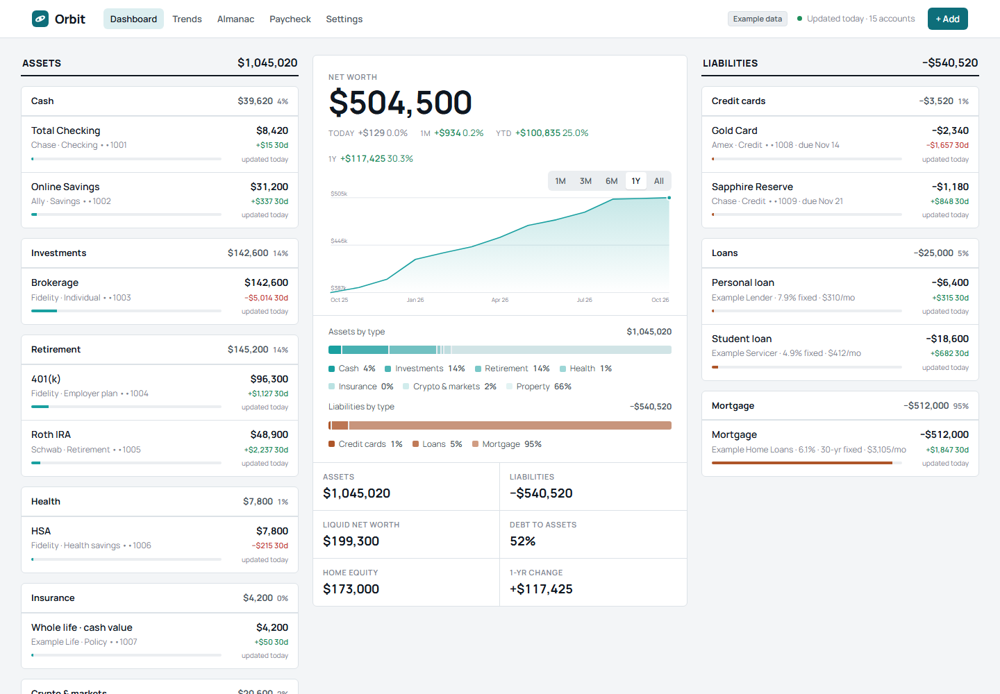

# Orbit

Open-source, self-hosted net-worth tracker for one person. Everything orbits your net worth.

Orbit puts your assets on the left, your net worth in the center and your liabilities on the right. Click an account to see its detail page. Orbit also has a paycheck page, a yearly almanac and trend charts. There are no budgets, no AI widgets and no upsells.



More screens: [account](docs/screenshots/account.png) · [trends](docs/screenshots/trends.png) · [almanac](docs/screenshots/almanac.png) · [paycheck](docs/screenshots/paycheck.png) · [mobile](docs/screenshots/mobile.png)

- **Live app docs:** `http://localhost:8000/docs`. These are the API docs built into your running Orbit (FastAPI's page). The page loads its viewer from a CDN, an outside file host.
- **Try the prototype (example data):** https://20nick00.github.io/orbit/
- **Contributing:** [CONTRIBUTING.md](CONTRIBUTING.md)

## 5-minute quickstart with Docker Compose

You need Git and Docker with Docker Compose installed.

**1. Download Orbit and create your settings file.**

Linux or macOS:

```bash
git clone https://github.com/20Nick00/orbit.git
cd orbit
cp .env.example .env
mkdir -p data
```

Windows (PowerShell):

```powershell
git clone https://github.com/20Nick00/orbit.git
cd orbit
copy .env.example .env
mkdir data
```

`.env` holds your settings. `data/` holds your database and backups. Git ignores both.

**2. Set your timezone.** Open `.env` in a text editor and set `ORBIT_TIMEZONE` to your timezone name, for example:

```
ORBIT_TIMEZONE=America/New_York
```

Docker's clock runs in UTC. Without this setting, Orbit can close a month too early.

**3. Start Orbit.**

```bash
docker compose up -d --build
```

The first run builds the Orbit image, which takes a while. `-d` runs Orbit in the background.

**4. Open Orbit.** Go to http://localhost:8000 in your browser.

**5. (Optional) Load example data.**

```bash
docker compose exec orbit python -m core.demo
docker compose restart orbit
```

The restart closes past months, which fills in Trends and the Almanac.

The command prints a line like `Demo ready: 15 accounts, 259 transactions, as of 2026-10-31.` The date is the current date. Inside Docker, that date is UTC.

What the example data does to your database:

- If the database holds only example data from an earlier run, the demo replaces it with a fresh set.
- If the database holds any other account, including one you added by hand, the demo stops with a "Demo refused" message and changes nothing.
- If an example account has a closed month, or a balance you edited by hand, the demo also refuses and changes nothing.

Orbit closes past months when it starts. After that, the demo refuses to replace the example data. To start over, stop Orbit, rename the `data` folder, make a new empty `data` folder, and start Orbit again. Renaming keeps your old data.

**Linux only: permission error on `data/`.** The Orbit container runs as user ID 1000. If Orbit can't write to `data/`, run:

```bash
sudo chown 1000:1000 data
```

**Everyday commands:**

- Stop Orbit. Your data stays in `data/`: `docker compose down`
- Start Orbit again: `docker compose up -d`
- After you edit `.env`: `docker compose up -d`
- Update to the newest code:

```bash
git pull
docker compose up -d --build
```

## Run without Docker

You need Python 3.12.

```bash
python -m venv .venv
source .venv/bin/activate  # Windows: .venv\Scripts\activate
pip install -r requirements-dev.txt
alembic upgrade head
uvicorn app.main:app --reload
```

Then open http://localhost:8000. Alembic is the tool that creates and updates the database tables.

The Makefile has shortcuts that use the `.venv` you just made:

- `make demo` loads the example data.
- `make run` starts Orbit at http://127.0.0.1:8000. It always uses port 8000. `ORBIT_PORT` is used only by Docker.
- `make test` runs the tests.

On Windows, you may not have `make`. Run `.\make demo`, `.\make run` or `.\make test` from the project folder instead. `.\make` runs `make.bat`, which does the same jobs.

## Tailscale: reach Orbit from your other devices

> **Orbit has no login.** Anyone who can reach its port can see all of your finances. Never expose Orbit to the internet, never port-forward it, and never point a public tunnel at the main port (8000).

Tailscale is a private network that links your own devices. Use it to reach Orbit from your phone or laptop without opening anything to the internet.

Recommended setup:

1. In `.env`, keep `ORBIT_BIND=127.0.0.1`. This makes Docker publish Orbit's port on this computer only.
2. In the Tailscale admin console (the web page for your private network, called a tailnet), turn on **MagicDNS** (which gives each device a name) and **HTTPS certificates**.
3. On the computer that runs Orbit, run:

```bash
tailscale serve --bg 8000
```

This serves Orbit over HTTPS through Tailscale. `--bg` keeps it running in the background.

4. Find this computer's name. It looks like `machine-name.tailnet-name.ts.net`. Add it to `ORBIT_ALLOWED_HOSTS` in `.env`, and keep the existing names:

```
ORBIT_ALLOWED_HOSTS=127.0.0.1,localhost,machine-name.tailnet-name.ts.net
ORBIT_PUBLIC_URL=https://machine-name.tailnet-name.ts.net
```

Orbit refuses requests sent to any other name. `ORBIT_PUBLIC_URL` is where Plaid sends you back after you link a bank.

5. Restart Orbit:

```bash
docker compose up -d
```

6. On any device signed in to your tailnet, open https://machine-name.tailnet-name.ts.net.

Every device in your tailnet can open Orbit. If you share your tailnet with other people, use Tailscale ACLs (access rules) to limit who can reach this computer.

**Alternative: plain HTTP on the Tailscale address.** Set `ORBIT_BIND` to this computer's Tailscale address, which starts with `100.`. Add that address to `ORBIT_ALLOWED_HOSTS`, run `docker compose up -d`, and open `http://100.x.y.z:8000` from another device. This works, but the phone install and the offline page will not. Browsers only run a service worker (a small background script) over HTTPS or on localhost.

These Tailscale steps have not yet been run end to end.

## Install on your phone (PWA)

A PWA (progressive web app) is a website you can add to your home screen.

1. Open your HTTPS address, such as https://machine-name.tailnet-name.ts.net, in your phone's browser.
2. Choose **Add to Home Screen** from the browser menu.

The app stores only its shell: the styles, scripts, fonts, icons and an offline page. It never stores your financial pages, so no financial data is on the phone. If Orbit can't reach your server, the app shows an offline notice.

## Your data and backups

Everything Orbit stores lives in `data/`:

- `data/orbit.sqlite` is your database.
- `data/backups/` holds your backups.
- `data/inbox/paystubs/` and `data/paystubs/` hold paystub files and employer rules.

Git ignores `data/`, so it is never committed.

**Backups.** Orbit backs up the database every night at 01:30 local time. If today's backup is missing when Orbit starts, it makes one then. Backups need the scheduler, which is on by default (`ORBIT_SCHEDULER_ENABLED=true`).

- Each backup is a file named like `data/backups/orbit-2026-10-31.sqlite`.
- Orbit keeps the newest `ORBIT_BACKUP_KEEP_DAYS` backups (default 30), one per day, and deletes older ones.
- The Settings page shows the date of the last backup. Check it now and then: a failed backup only writes a warning to the log.
- Backups copy the database only. Paystub PDFs and employer rules in `data/paystubs/` and `data/inbox/` are not in them.

To make a backup now:

- With Docker: `docker compose exec orbit python -m jobs.backup`
- Without Docker, with `.venv` active: `python -m jobs.backup`

The command prints the name of the new file.

**To restore a backup:**

1. Stop Orbit. With Docker, run `docker compose down`. Without Docker, press Ctrl+C in the terminal that runs Orbit.
2. Keep a copy of the current database. Copy `data/orbit.sqlite` to a new name, such as `orbit-before-restore.sqlite`.
3. Copy the backup you want over `data/orbit.sqlite`.
4. Delete `data/orbit.sqlite-wal` and `data/orbit.sqlite-shm` if they exist. They belong to the old database.
5. Start Orbit again.

**Keep copies off this computer.** Backups sit on the same disk as your data. Copy all of `data/` to another drive or place as well. On Linux with Docker, backup files belong to the container's user (uid 1000) and only that user can read them, so you may need `sudo` to copy them.

Backups contain your full financial history, so keep them as private as the original. Bank connection tokens are stored encrypted. The key (`FERNET_KEY`) is in `.env`, not in the backup. Without that key, saved bank connections can't be read, and you must reconnect each bank. Store a copy of `FERNET_KEY` somewhere safe, apart from your backups.

## Connections (all optional)

Orbit works without any connections.

- **Files and manual accounts.** CSV (a spreadsheet export) and OFX (a bank file format) imports, and manual accounts, need no setup. Use the Add page.
- **Plaid (banks, cards, loans and brokerages).** Plaid is a service that connects Orbit to your financial institutions. You need:
  1. Your Plaid client ID and secret, from your Plaid dashboard. Put them in `.env` as `PLAID_CLIENT_ID` and `PLAID_SECRET`.
  2. A `FERNET_KEY`, described below.
  3. `PLAID_ENV` in `.env`. Leave it blank to use Plaid's sandbox, which is a test environment with test banks. Set it to `production` to connect real accounts. Plaid's pay-as-you-go charges may apply in production. Sandbox is free.

  Restart Orbit, open the Settings page (`/settings`), and choose **Connect a bank, card or loan** or **Connect a brokerage or retirement account**.

  To make a `FERNET_KEY`, run this command once. Orbit uses the key to encrypt your bank tokens.

  With Docker, while Orbit is running:

  ```bash
  docker compose exec orbit python -c "from cryptography.fernet import Fernet; print(Fernet.generate_key().decode())"
  ```

  Without Docker, on Windows:

  ```powershell
  .venv\Scripts\python.exe -c "from cryptography.fernet import Fernet; print(Fernet.generate_key().decode())"
  ```

  Without Docker on macOS or Linux, use `.venv/bin/python` instead.

  Copy the printed line into `.env` as `FERNET_KEY=...`, then restart Orbit. If you lose this key, you must reconnect every bank.

  Webhooks are optional. Read the comments about `PLAID_WEBHOOK_URL` in `.env.example` before you set it.

- **RentCast (property values).** RentCast has a free tier. Add `RENTCAST_API_KEY` to `.env` for automatic estimates of your property's value. Orbit makes at most `ORBIT_RENTCAST_MONTHLY_LIMIT` requests in any 31 days (default 45, maximum 50). Failed requests count too. Leave the key blank to enter property values by hand. The limit applies per database, so don't share one RentCast key between installs.

- **Paystubs.** Drop a paystub PDF into `data/inbox/paystubs/`, or use **Import paystub** on the Paycheck page. The first stub from a new employer opens a one-time mapping screen. That screen saves a rule to `data/paystubs/rules/`. After that, stubs from that employer import on their own, unless something looks wrong. Those wait under **Needs attention**. Only PDFs with real text work. Scans and password-protected PDFs are listed with the reason.

  To fetch paystub PDFs from a mailbox once a month, set the `PAYSTUB_IMAP_*` values in `.env` (see `.env.example`). Use an app password, never your main password. Set a sender, a label, or both. Orbit reads your mail only. It never changes, moves or marks it.

## Security

- Bank tokens are encrypted with Fernet, a standard encryption format from the Python `cryptography` package, before they are saved. Orbit has no plaintext fallback. Without `FERNET_KEY`, Orbit refuses to connect a bank.
- Every form carries a CSRF token. CSRF (cross-site request forgery) is a trick where another website makes your browser submit a form to Orbit. Orbit also refuses form submissions that come from another site.
- Secrets stay out of logs. Access logs drop query strings, the part of a web address after `?`.
- Orbit accepts requests only for the host names in `ORBIT_ALLOWED_HOSTS`.
- Orbit has no login. Your network is the security boundary. Keep Orbit on this computer (`ORBIT_BIND=127.0.0.1`) or on your tailnet.

To report a security problem, open a private security advisory on the GitHub repository. Please don't post security problems as public issues.

## Project status

Orbit is an early release. Here is what has been tested and what has not:

- **Plaid:** built and tested with simulated Plaid responses. It has not yet run against Plaid's real sandbox.
- **CSV and OFX import:** tested with made-up files. Not yet tried on real bank exports.
- **Paystub parser:** tested on made-up PDF layouts. Not yet tried on a real paystub.
- **Docker setup:** the quickstart runs from start to finish on every change in GitHub's automated checks (Linux). Not yet tried on Docker Desktop for Windows or Mac.
- **Scope:** single user only. Budgets, multi-user and native apps are not in version 1.

Known issues:

- An account added late is not counted in months that were already closed. Use **Reopen month**, then **Close month**, on an account page to include it.
- Mortgage principal payments show as market gain, because Orbit does not split payments into interest and principal yet.
- An account that sells all its holdings keeps showing its last holdings.

## License

MIT. See [LICENSE](LICENSE).
